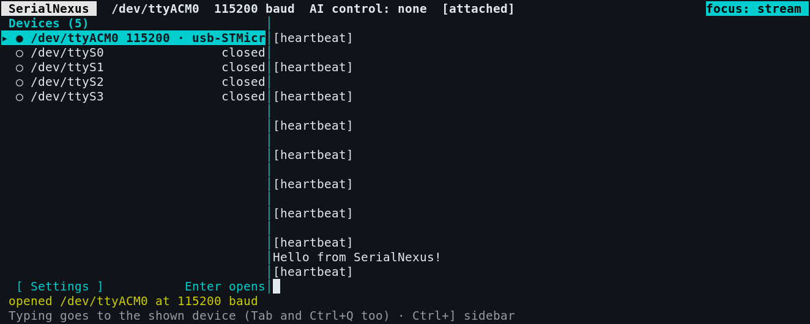

# SerialNexus

Copyright 2026 Alvin La. Licensed under the [Apache License, Version 2.0](LICENSE).

SerialNexus lets AI clients and humans share serial devices through one local
core. The core owns each device; the MCP server gives AI hosts tool access, and
an interactive terminal lets a human observe and type without taking AI control.
Linux is supported; macOS and Windows are not currently supported.



*The terminal connected to an STM32 Nucleo board: devices on the left, live serial output on the right.*

## Table of contents

- [Quick start](#quick-start)
  - [Nix](#nix)
  - [Cargo](#cargo)
  - [Connect an AI host](#connect-an-ai-host)
- [How it works](#how-it-works)
- [Documentation](#documentation)
- [Contributing](#contributing)
- [License](#license)

## Quick start

You'll need access to your serial device. See [Linux serial permissions](docs/getting-started.md#linux-serial-permissions)
if opening it fails with a permission error. The first client starts the core
automatically; no separate service is needed.

### Nix

With Nix flakes enabled, start the human terminal directly:

```sh
nix run github:alvinla264/SerialNexus
```

### Cargo

With Rust and Cargo installed, clone and build the workspace:

```sh
git clone https://github.com/alvinla264/SerialNexus.git
cd SerialNexus
cargo build --release
./target/release/serial-nexus-terminal
```

The same build also produces `target/release/serial-nexus-core` and
`target/release/serial-nexus-mcp`. See
[Installing](docs/getting-started.md#installing) for prerequisites and
installation options.

### Connect an AI host

Configure an MCP-compatible host to start the MCP server. For example, with Nix:

```json
{
  "mcpServers": {
    "serial": {
      "command": "nix",
      "args": ["run", "github:alvinla264/SerialNexus#serial-nexus-mcp"]
    }
  }
}
```

For a Cargo build, use the absolute path to `target/release/serial-nexus-mcp`
as the command. See the
[MCP guide](docs/clients.md#mcp-server-serial-nexus-mcp) for tools and
configuration details.

## How it works

- **serial-nexus-core** owns devices and enforces one AI writer per device, while
  allowing multiple readers and human writes.
- **serial-nexus-mcp** exposes devices to an AI host through MCP tool calls.
- **serial-nexus-terminal** provides the human terminal: a device sidebar
  beside the live stream of the device you are watching.
- **serial-nexus-client** and **serial-nexus-protocol** share the core interface
  and communication types, including the opt-in LAN sharing seam.

The first client opening a device chooses its baud rate; later clients share
that rate. See [Behaviour and defaults](docs/getting-started.md#behaviour-and-defaults)
for control, history, and lifecycle details.

## Documentation

- [Installation, running, and device behavior](docs/getting-started.md)
- [Client library, human terminal, and MCP server](docs/clients.md)
- [Security, building, and testing](docs/development.md)
- [LAN sharing internal contract](docs/sharing.md)
- [MCP tool reference](crates/serial-nexus-mcp/README.md)

## Contributing

Contributions are welcome, including bug reports, documentation, tests, and
code. To contribute:

1. Open an issue to report a bug or discuss a proposed change. Include steps to
   reproduce bugs, the expected and actual behavior, and relevant system details.
2. Fork the repository, create a branch, and make your changes. Add or update
   tests where appropriate.
3. Run the formatting, lint, and test commands in [Building and testing](docs/development.md#building-and-testing).
4. Open a pull request against `main` describing the change and how you tested it.
   Link the related issue if there is one.

Use [Conventional Commits](https://www.conventionalcommits.org/en/v1.0.0/) for
commit messages. Pull requests are squash-merged with a conventional commit
message. Contributions are subject to the project's [Apache 2.0 license](LICENSE).

## License

SerialNexus is licensed under the [Apache License, Version 2.0](LICENSE).
